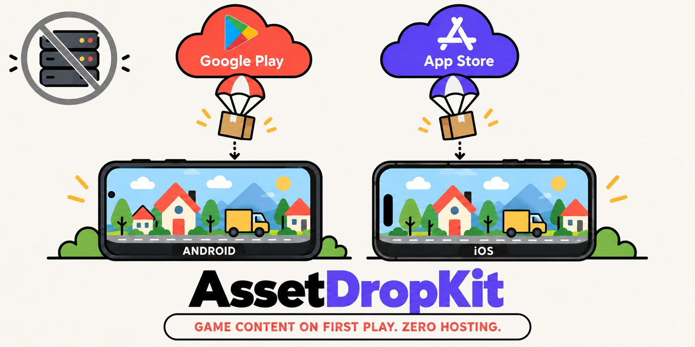

# AssetDropKit



Built for [Vocabloot](https://vocabloot.com), the photo vocabulary app for iOS and Android. Part of the [Vocabloot open-source libraries](https://vocabloot.com/oss).

Kotlin Multiplatform asset packs, downloaded on first use from the app stores themselves: **Google Play Asset Delivery** on Android, **Apple-hosted Background Assets** on iOS 26 and later, **On-Demand Resources** on iOS 17 and 18. The stores host the bytes. **No server, no hosting bill.**


[](https://central.sonatype.com/artifact/com.vocabloot/assetdropkit)
[](https://github.com/vaazh-studios/assetdropkit/actions/workflows/ci.yml)
[](https://kotlinlang.org)
[](LICENSE)
[](https://vaazh-studios.github.io/assetdropkit/)
[](https://github.com/vaazh-studios/assetdropkit/discussions)

- [Why](#why) · [Features](#features) · [AssetDropKit 101](#assetdropkit-101) · [A more advanced example](#a-more-advanced-example)
- [Support matrix](#support-matrix) · [Requirements](#requirements) · [Samples](#samples) · [Testing](#testing)
- [Who's using it](#whos-using-it) · [Communication](#communication) · [Limits](#limits) · [Compared with](#compared-with)

## Why

Games make an app big, and most players never open most of them. Shipping every game's art in the install costs downloads; hosting it yourself costs egress on every new device. Both stores already deliver extra content after install, for free, but each with its own API, states and packaging, and Apple has two systems depending on the iOS version. AssetDropKit gives Kotlin one API over all three, one pack layout, and one integrity check.

## Features

- **Store-hosted, zero cost.** Play hosts on-demand asset packs; the App Store hosts Apple-hosted packs and On-Demand Resources tags. Nothing runs on your servers.
- **One API, three systems.** `AssetPacks.fetch`, `state`, `readBytes`, `remove`, with the same `PackState` names on every store.
- **Picks Apple's system by OS.** Apple-hosted Background Assets on iOS 26 and later, On-Demand Resources on 17 and 18, from one Swift package.
- **Never loads a half pack.** Each pack is checked against its `assetdropkit.json` (SHA-256 per file) once per version; a mismatch is removed, fetched once more, then reported as `Failed(Corrupt)`. `state()` says Ready only after the check.
- **Shared and cancellable.** Two screens fetching one pack make one store request; cancelling the last caller cancels the download.
- **Survives a relaunch.** The first state comes from the store, so a download that was running shows as running.
- **Offline-aware.** `stallTimeoutMillis` turns a download that stops moving into `Failed(NoNetwork)`.
- **No Objective-C.** Every Apple call is Swift; Kotlin talks to it through a short adapter in your app.

## AssetDropKit 101

```kotlin
// libs.versions.toml            assetdropkit = { module = "com.vocabloot:assetdropkit", version = "0.1.1" }
// build.gradle.kts (shared)     commonMain.dependencies { api(libs.assetdropkit) }
```

Package each pack once ([packaging](https://vaazh-studios.github.io/assetdropkit/packaging/)), then:

```kotlin
// Android (androidMain)                                       // iOS (iosMain); store = the app's AssetDropAdapter
val source = PackSources.default(context, BuildConfig.DEBUG)   val source = AppleStoreSource(store = store)

// common
val packs = AssetPacks(source = source, stallTimeoutMillis = 20_000)

when (val state = packs.fetch("postdelivery")) {
    PackState.Ready -> {
        val glb = packs.readBytes("postdelivery", "town/sedan.glb")
    }
    is PackState.Failed -> showFallback(state.reason)       // NoNetwork, InsufficientStorage, Corrupt, ...
    else -> askTheUser()                                    // WaitingForWifi, NeedsPlayConfirmation (Android)
}
```

## A more advanced example

Show progress while the pack arrives, and switch to the downloaded art only once it is verified:

```kotlin
@Composable
fun GameIntro(packs: AssetPacks) {
    val state by remember { packs.state("postdelivery") }.collectAsState(initial = null)
    LaunchedEffect(Unit) { packs.fetch("postdelivery") }
    when (val s = state) {
        is PackState.Downloading -> ProgressLine(s.bytes, s.totalBytes)
        PackState.Ready -> PlayWithPackArt()              // Ready means checked against the manifest
        is PackState.Failed -> PlayWithBuiltInArt()       // and fetch again next time
        else -> Unit
    }
}
```

On Android, register Play's prompts in `onCreate` (`packs.registerPlayPrompts(this)`) and call `show()` on `WaitingForWifi` or `NeedsPlayConfirmation`. On iOS, copy [`templates/ios/AssetDropAdapter.swift`](templates/ios/AssetDropAdapter.swift) into the app. More in [recipes](https://vaazh-studios.github.io/assetdropkit/recipes/).

## Support matrix

| | Play Asset Delivery (Android) | Apple-hosted (iOS 26+) | On-Demand Resources (iOS 17, 18) |
|---|---|---|---|
| Source | `PlayAssetPacks` | `AppleStoreSource` | `AppleStoreSource` |
| Pack ships with | the app bundle | its own upload and review | the app build |
| App setup | `registerPlayPrompts` | downloader extension, App Group, Info.plist keys | `ENABLE_ON_DEMAND_RESOURCES` |
| Checked with | Play local testing, emulator, 2026-10-24 | unit tests | iPhone simulator, iOS 26, 2026-10-24 |

Debug APKs read packs bundled as plain assets (`BundledAssetPacks`); release builds read only from Play. Every row and state: [support matrix](https://vaazh-studios.github.io/assetdropkit/support-matrix/).

## Requirements

| | Minimum | Built with |
|---|---|---|
| Kotlin / AGP | 2.3 / 9.0 | 2.3.20 / 9.2.1 |
| Android | minSdk 24 | compileSdk 36 |
| iOS / Xcode / Swift | 17 / 26 / 6.0 | iOS 26 / Xcode 26.6 / Swift 6.3 |

Targets: `android`, `iosArm64`, `iosSimulatorArm64`. Versioning: [stability](https://vaazh-studios.github.io/assetdropkit/stability/).

## Samples

| Sample | Shows |
|---|---|
| [Demo pack](sample/README.md) | fetch with progress, the image from the pack, remove; Play local testing on Android, On-Demand Resources and an Apple-hosted downloader extension on iOS |

## Testing

`com.vocabloot:assetdropkit-test` (same version) ships `FakePackSource`, the fake the library's own tests run on:

```kotlin
val fake = FakePackSource().apply {
    pack(packId = "postdelivery", version = 1, files = mapOf("town/sedan.glb" to glbBytes))
    script("postdelivery", PackState.NotDownloaded, PackState.Downloading(1, 2), PackState.Ready)
}
val packs = AssetPacks(source = fake, dispatcher = StandardTestDispatcher(testScheduler))
```

Store-side testing (internal app sharing, `ba-serve`, TestFlight): [testing](https://vaazh-studios.github.io/assetdropkit/testing/).

## Who's using it

- [Vocabloot](https://vocabloot.com) ([App Store](https://apps.apple.com/app/id6792888619), [Google Play](https://play.google.com/store/apps/details?id=com.tntstudios.snaplingo)): AssetDropKit was built for Vocabloot's games; the Post Delivery game's 3D town is its first pack.

Using AssetDropKit? Open a PR and add yourself.

## Communication

- Questions and ideas: [Discussions](https://github.com/vaazh-studios/assetdropkit/discussions).
- Bugs: [Issues](https://github.com/vaazh-studios/assetdropkit/issues/new/choose), with the `PackState` and the store.
- Security: [SECURITY.md](SECURITY.md), privately.
- Contributing: [CONTRIBUTING.md](CONTRIBUTING.md). Conduct: [CODE_OF_CONDUCT.md](CODE_OF_CONDUCT.md).

## Limits

- On-Demand Resources is deprecated by Apple (no removal date); iOS 26 and later use Apple-hosted packs.
- An Apple-hosted pack version reaches every installed app version once approved; keep contents backward-compatible and use a new pack ID for breaking changes (100 packs per app, IDs never reused).
- On-Demand Resources cannot re-download a changed pack, so its integrity retry reports `Failed(Corrupt)`.
- Files are read into memory whole; keep single files to tens of megabytes.
- Packaging is two scripts and a checked-in asset-pack module; a Gradle plugin is a later version.

Open items with workarounds: [known issues](https://vaazh-studios.github.io/assetdropkit/known-issues/).

## Compared with

| | Bundle everything | Firebase Storage or a CDN | Play Asset Delivery directly | Unity Addressables | AssetDropKit |
|---|---|---|---|---|---|
| Install size | large | small | small | small | **small** |
| Hosting cost | none | per GB of egress | none | depends on the host | **none** |
| Android and iOS from one API | yes | yes | Android only | Unity only | **yes, Kotlin Multiplatform** |
| Apple's iOS 26 and iOS 17/18 systems | n/a | n/a | no | no | **both, picked by OS** |
| Integrity check before use | n/a | yours | no | yours | **yes** |

## Documentation

[Docs site](https://vaazh-studios.github.io/assetdropkit/): setup for Android and iOS, packaging, support matrix, testing, recipes, FAQ, known issues, limits, stability. [API reference](https://vaazh-studios.github.io/assetdropkit/api/) (Dokka). Design notes and publishing steps are in [docs/](docs/) for maintainers.

## Dependencies

Kotlin: kotlinx-coroutines, kotlinx-serialization-json, kotlinx-io; on Android, `com.google.android.play:asset-delivery-ktx` and `androidx.activity`. Swift: Foundation and BackgroundAssets only.

## License

Apache 2.0. Made by [Vaazh Studios](https://github.com/vaazh-studios).
