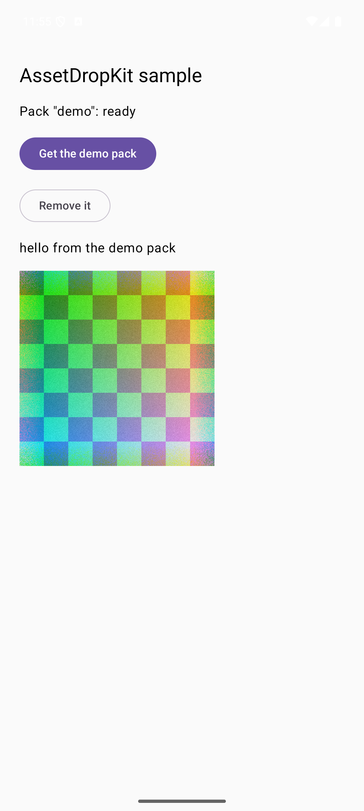
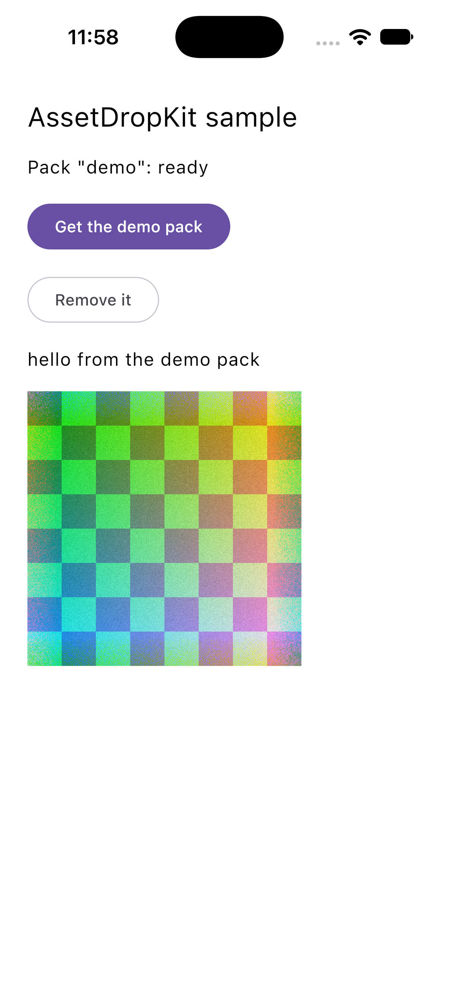

# AssetDropKit

Kotlin Multiplatform asset packs, downloaded on first use from the app stores themselves:

| Platform | Delivery | Hosted by |
| --- | --- | --- |
| Android (minSdk 24) | Play Asset Delivery, on-demand packs | Google Play |
| iOS 26 and later | Apple-hosted Background Assets | the App Store |
| iOS 17 and 18 | On-Demand Resources | the App Store |

The stores host the bytes, so there is no server and no hosting bill. Your app keeps its install
size small and fetches a game's art the first time someone plays it.

## Quickstart

```kotlin
// commonMain
val packs = AssetPacks(source = source) // PlayAssetPacks on Android, AppleStoreSource on iOS

when (val state = packs.fetch("postdelivery")) {
    PackState.Ready -> {
        val glb = packs.readBytes("postdelivery", "town/sedan.glb")
    }
    is PackState.Failed -> showOfflineFallback(state.reason)
    else -> askTheUser() // WaitingForWifi or NeedsPlayConfirmation, Android only
}

packs.state("postdelivery").collect { state -> showProgress(state) }
```

- Two callers fetching the same pack share one store request.
- Every pack is checked against its `assetdropkit.json` once per version; a changed or missing file removes the pack, fetches it once more, then reports `Failed(Corrupt)`.
- `readBytes` runs on the dispatcher you inject (default `Dispatchers.Default`), never on the caller's thread.
- After a relaunch, the first state comes from the store, so a download that was running shows as running; a store's Ready becomes Ready only once the pack matches its manifest.
- `stallTimeoutMillis` turns a download that stops moving (offline, parked in Pending) into `Failed(NoNetwork)`.

{ width="240" }
{ width="240" }

## Install

```kotlin
// shared module
commonMain.dependencies { api("com.vocabloot:assetdropkit:0.1.0") }
commonTest.dependencies { implementation("com.vocabloot:assetdropkit-test:0.1.0") }
```

The Apple side is a Swift package: add `https://github.com/vaazh-studios/assetdropkit` in Xcode.
Then follow [Android](android.md), [iOS](ios.md) and [Packaging](packaging.md).
